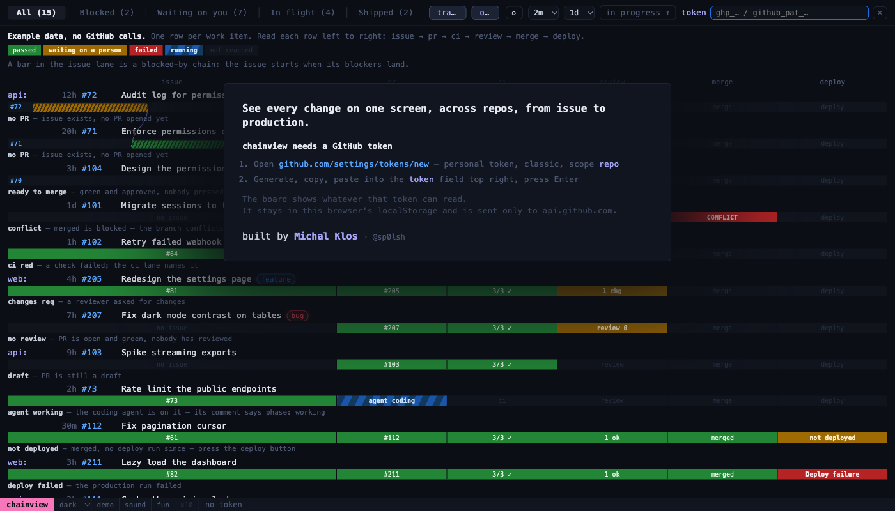
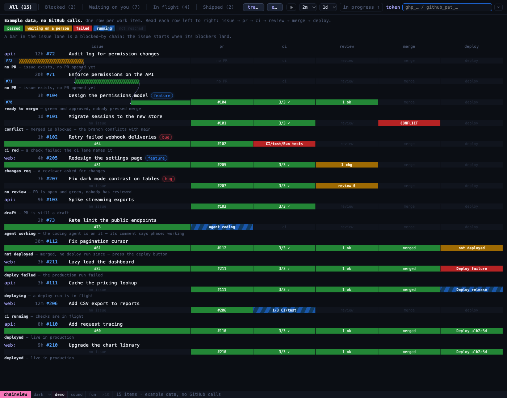

# chainview

See every change on one screen, across repos, from issue to production.

Live: https://sp0lsh.github.io/chainview/



## What a row shows

One row per work item, read left to right:

```
issue → pr → ci → review → merge → deploy
```

The tabs group rows into Blocked, Waiting on you, In flight and Shipped.



## Use

1. Open the page. Without a token it shows example data; the `demo` toggle in the bottom bar shows that board at any time.
2. Create a [classic personal token](https://github.com/settings/tokens/new?scopes=repo&description=chainview) with scope `repo`.
3. Paste it into the `token` field and press Enter.
4. Press `tracking` and pick the repos to follow.

## Token

The token is kept in this browser's `localStorage` and sent only to `api.github.com`. The page has no backend.

`localStorage` is per origin, and every project page under `sp0lsh.github.io` shares that origin, so those pages could read the token. To avoid that, run chainview locally.

## Run locally

It is one static file with no build step:

```
python3 -m http.server --bind 127.0.0.1
```

Then open http://127.0.0.1:8000/.

## License

AGPL-3.0
